<div align="center">
  
  &nbsp;&nbsp;&nbsp;&nbsp;
  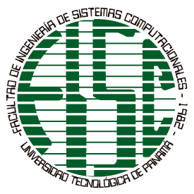
</div>

<div align="center">

### UNIVERSIDAD TECNOLÓGICA DE PANAMÁ
**Facultad de Ingeniería en Sistemas Computacionales**  
**Asignatura:** Desarrollo Web VII: PHP y MySQL  
**Laboratorio de OpenSSL y Libsodium**

**Profesora:** Ing. Irina Fong

**Integrante:** Hanna Licona

**Fecha de entrega:** 30 de octubre de 2026  
**Período académico:** II semestre de 2026

</div>

---

# 📑 Índice

1. [📖 Introducción](#1--introducción)
2. [🎯 Objetivos](#2--objetivos)
3. [💻 Descripción del proyecto](#3--descripción-del-proyecto)
4. [🖼️ Evidencias de ejecución](#4--evidencias-de-ejecución)
5. [🔐 Documentación técnica de las funciones](#5--documentación-técnica-de-las-funciones)
6. [🧪 Investigación sobre Libsodium](#6--investigación-sobre-libsodium)
7. [💭 Conclusiones personales](#7--conclusiones-personales)

---

# 1. 📖 Introducción

La criptografía aplicada permite proteger la confidencialidad, integridad,
autenticidad y trazabilidad de la información. En este laboratorio se
implementan ejemplos en PHP utilizando OpenSSL y Libsodium para generar pares
de claves, firmar y verificar mensajes, crear certificados, cifrar datos y
proteger contraseñas mediante funciones de derivación de claves.

OpenSSL permite trabajar con algoritmos ampliamente utilizados como RSA, AES,
SHA-256 y certificados X.509. Libsodium ofrece una API moderna con valores
seguros por defecto para cifrado autenticado, firmas digitales y hashing de
contraseñas. En conjunto, los ejercicios relacionan la teoría criptográfica
con la protección de datos sensibles recomendada por OWASP.

# 2. 🎯 Objetivos

- Comprender el uso práctico de la criptografía asimétrica y simétrica.
- Generar y administrar claves públicas y privadas sin exponer material secreto.
- Crear y verificar firmas digitales para detectar modificaciones.
- Comprender el propósito de certificados X.509, CSR, PEM y `openssl.cnf`.
- Cifrar y descifrar información usando AES mediante OpenSSL.
- Investigar Libsodium y ejecutar operaciones de cifrado autenticado, firma y
  hashing de contraseñas.
- Documentar las funciones criptográficas con claridad y relacionarlas con la
  protección de datos sensibles.

# 3. 💻 Descripción del proyecto

El proyecto contiene ejemplos ejecutables en PHP para explorar diferentes
operaciones criptográficas. Los archivos que generan claves, certificados y
firmas producen esos artefactos únicamente en el entorno local; están
excluidos del repositorio mediante `.gitignore`.

## 3.1. 🔩 Tecnologías utilizadas

| Tecnología | Uso en el proyecto |
|---|---|
| PHP | Lenguaje de implementación de los ejemplos |
| OpenSSL | RSA, AES, firmas digitales, CSR y certificados X.509 |
| Libsodium | Cifrado autenticado, Ed25519 y Argon2id |
| WAMP/XAMPP | Servidor local para ejecutar los archivos PHP |
| Git y GitHub | Control de versiones y publicación del proyecto |
| OWASP | Referencia para la protección de datos sensibles |

## 3.2. ⚙️ Configuración y ejecución

1. Instalar PHP con las extensiones `openssl` y `sodium` habilitadas.
2. Copiar el proyecto dentro de `www` (WAMP) o `htdocs` (XAMPP).
3. Si la instalación requiere una ruta explícita, configurar:

   ```powershell
   $env:OPENSSL_CONF = 'C:\ruta\de\tu\php\extras\ssl\openssl.cnf'
   ```

4. Abrir los scripts desde `http://localhost/SeguridadOpenSSL-main/`.
5. Generar nuevas claves localmente. Nunca publicar claves privadas reales.

# 4. 🖼️ Evidencias de ejecución

## 4.1. Conceptos básicos

| Concepto | Descripción |
|---|---|
| Llave privada | Secreto que debe permanecer bajo control exclusivo de su propietario |
| Llave pública | Valor que se comparte para cifrar o verificar firmas |
| Hash | Huella de longitud fija; no está diseñado para recuperar el texto original |
| Firma digital | Evidencia criptográfica de autenticidad e integridad |
| Verificación | Comprobación de que un mensaje corresponde a una firma |
| Certificado X.509 | Estructura que vincula una identidad con una clave pública |
| CSR | Solicitud de firma de certificado que contiene identidad y clave pública |
| AES | Cifrado simétrico que utiliza una clave para cifrar y descifrar |
| Base64 | Codificación de datos binarios como texto transportable |
| PEM | Formato textual delimitado para claves, certificados y solicitudes |
| `openssl.cnf` | Archivo de configuración utilizado por OpenSSL |

## 4.2. Evidencia de `firma7.php`

**Descripción:** genera un par RSA, firma un mensaje y verifica la firma con la
clave pública.  
**Datos que solicita:** no solicita datos al usuario; utiliza un mensaje de
prueba definido en el código.  
**Resultado esperado:** `la firma es valida y los datos son confiables`.

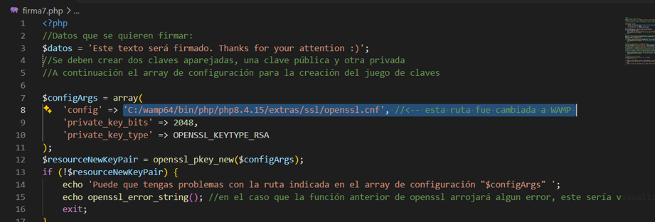

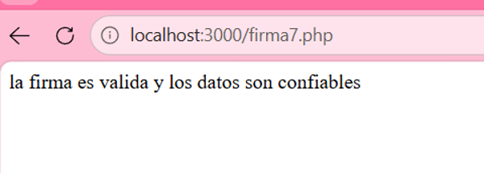

**Cómo funciona:** crea la clave con `openssl_pkey_new()`, obtiene la clave
pública, exporta la privada, firma con SHA-256 y valida con
`openssl_verify()`.

## 4.3. Evidencia de `firmaOtra.php`

**Descripción:** genera un par RSA y un certificado X.509 autofirmado mediante
una CSR.  
**Datos que solicita:** los datos de identificación definidos en `$dn`.  
**Resultado esperado:** se muestra un certificado PEM correctamente generado.

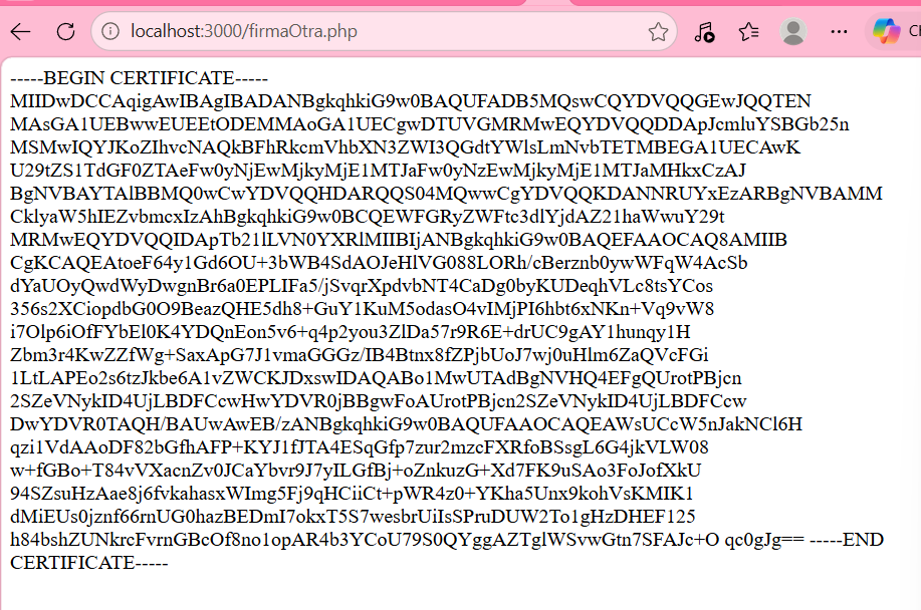

**Cómo funciona:** crea el par de claves, construye una CSR con
`openssl_csr_new()`, firma la solicitud con `openssl_csr_sign()` y exporta el
certificado con `openssl_x509_export()`.

## 4.4. Evidencia de `FirmarMesaje.php`

**Descripción:** firma un mensaje con la clave privada y verifica el resultado
con el certificado público.  
**Datos que solicita:** utiliza el mensaje definido en el script y los archivos
generados localmente.  
**Resultado esperado:** se muestra una firma Base64 y `Firma válida`.

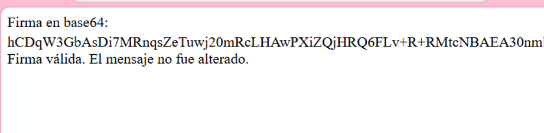

## 4.5. Evidencia de `firmaDigital.php`

**Descripción:** crea y guarda un par de claves RSA, mostrando la clave pública.  
**Datos que solicita:** no solicita datos al usuario.  
**Resultado esperado:** mensaje de generación correcta de las claves.

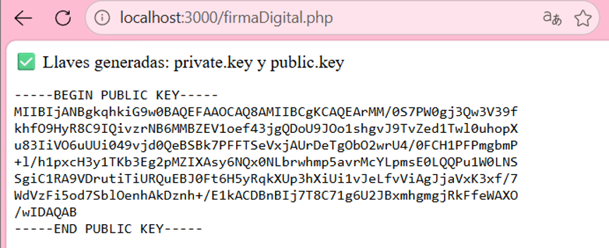

## 4.6. Evidencia de `encriptacionOpenssl_2.php`

**Descripción:** demuestra el cifrado de un texto con OpenSSL.  
**Datos que solicita:** el texto y la clave definidos en el ejemplo.  
**Resultado esperado:** se obtiene una salida cifrada en Base64.

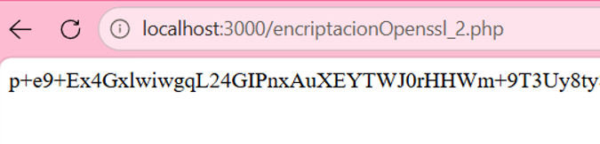

## 4.7. Evidencia de `Encriptacion.php` (cifrar y descifrar)

**Descripción:** ofrece una interfaz para cifrar y descifrar con AES-128-CBC
o AES-128-GCM.  
**Datos que solicita:** algoritmo, texto, clave, paquete cifrado y opción de
simular una alteración.  
**Resultado esperado:** el texto se recupera correctamente; una alteración debe
ser detectada especialmente en GCM.

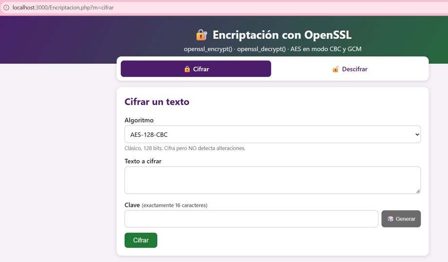

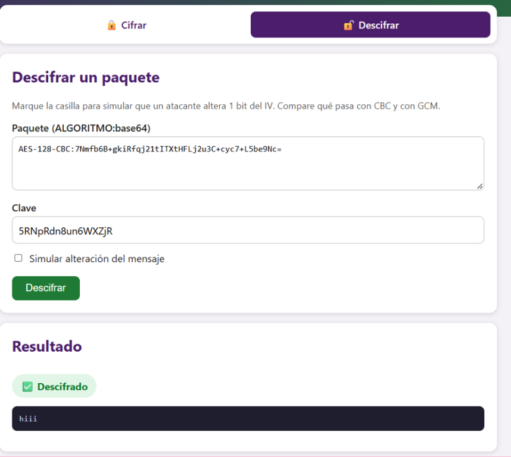

## 4.8. Evidencia de `sodiumEjemplo.php`

**Descripción:** integra cifrado autenticado, descifrado, firma Ed25519 y hash
de contraseñas con Libsodium.  
**Datos que solicita:** texto o dato sensible, contraseña, paquete, mensaje,
firma y clave pública según la operación elegida.  
**Resultado esperado:** cifrado y descifrado correctos, firma válida o
inválida cuando el mensaje cambia, y coincidencia de contraseña.

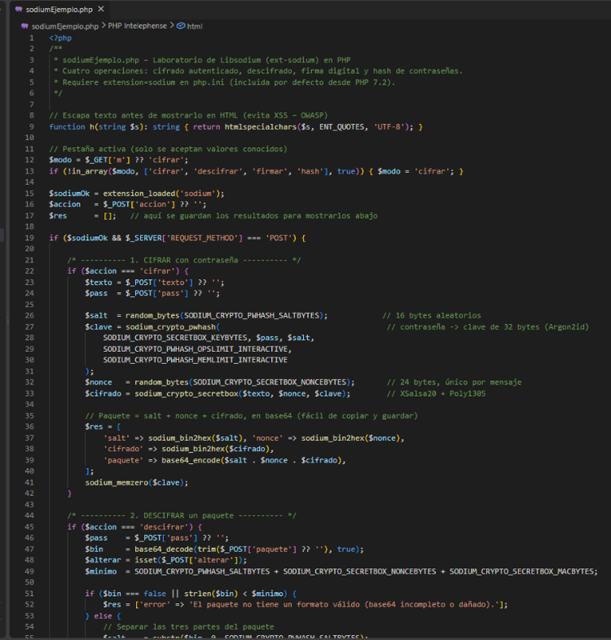

**Explicación:** esta imagen muestra la estructura principal de
`sodiumEjemplo.php`. El script identifica la operación seleccionada
(`cifrar`, `descifrar`, `firmar` o `hash`) y procesa la solicitud `POST`.
También se observa que el texto se escapa antes de mostrarse en HTML y que se
generan valores aleatorios para el `salt` y el `nonce`. Esto evita reutilizar
valores criptográficos y reduce riesgos de XSS en la salida.

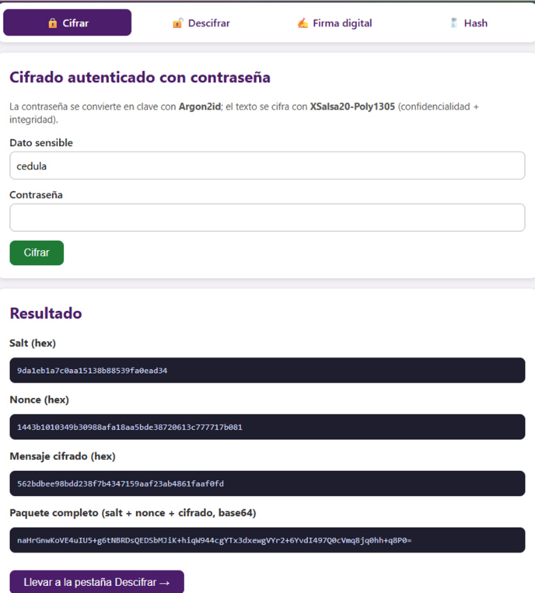

**Explicación:** en esta captura se cifra el dato sensible `cedula` mediante
una contraseña. Libsodium genera un `salt`, deriva una clave con Argon2id y
crea un nonce. Después, `sodium_crypto_secretbox()` cifra el mensaje con
XSalsa20-Poly1305. El resultado presenta el `salt`, el `nonce`, el mensaje
cifrado y el paquete completo en Base64. La clave derivada no se muestra.

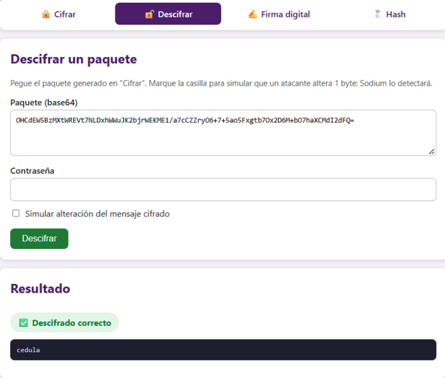

**Explicación:** aquí se pega el paquete cifrado y se introduce la contraseña.
El programa separa el `salt`, el `nonce` y el texto cifrado, vuelve a derivar la
misma clave y ejecuta `sodium_crypto_secretbox_open()`. El resultado
`Descifrado correcto` y el texto `cedula` demuestran que el paquete no fue
alterado y que la contraseña es válida.

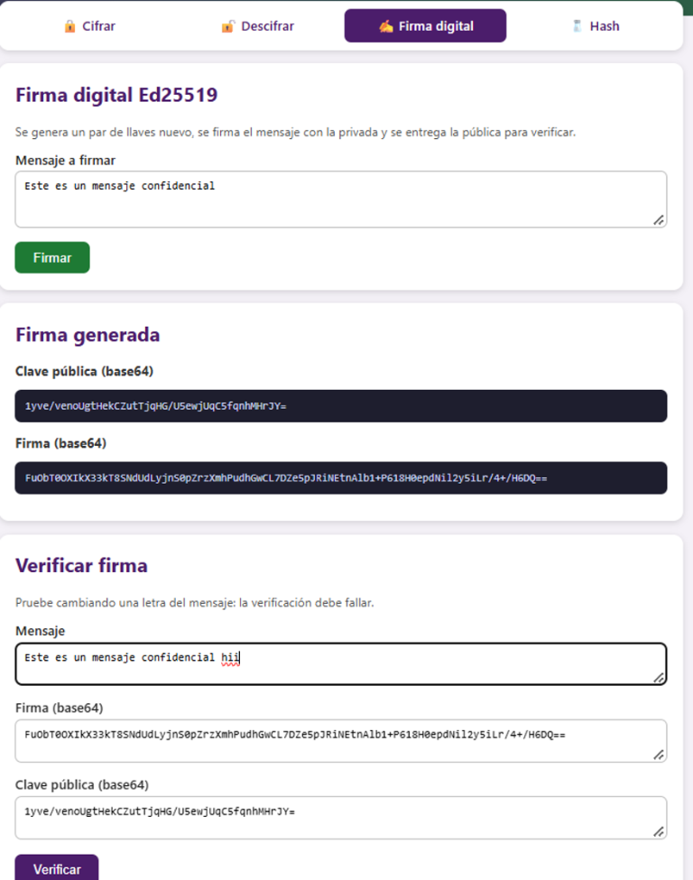

**Explicación:** esta imagen muestra la operación de firma digital. Se genera
un par de claves Ed25519, se firma el mensaje con la clave privada y se
entregan la firma y la clave pública codificadas en Base64. La clave privada
se utiliza internamente y no se presenta al usuario, mientras que la clave
pública puede compartirse para verificar la firma.

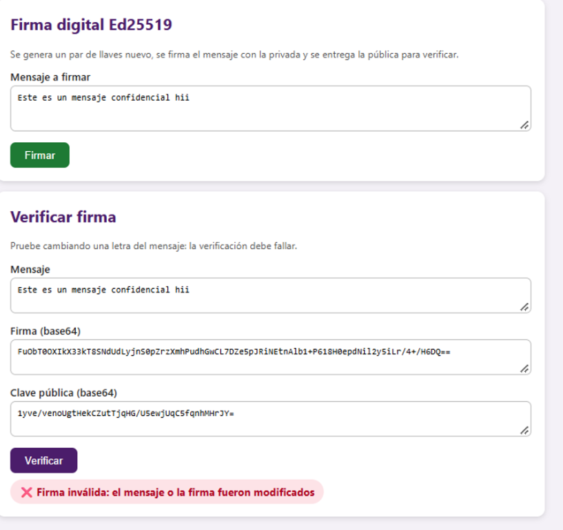

**Explicación:** en esta prueba se modifica el mensaje después de generar la
firma. Aunque se utilicen la misma firma y clave pública, la verificación
devuelve `Firma inválida`. Esto demuestra la integridad: un solo cambio en el
mensaje altera su huella criptográfica y hace que la firma ya no corresponda.

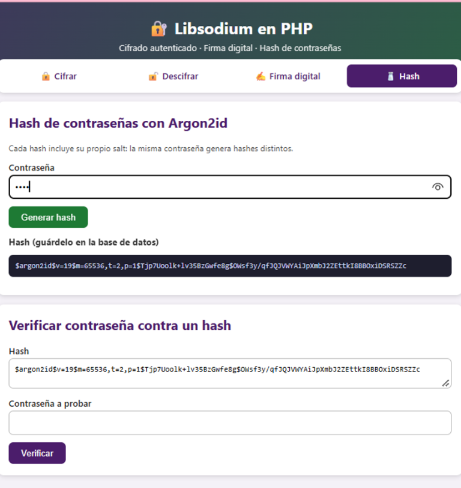

**Explicación:** la captura muestra la generación de un hash para una
contraseña. `sodium_crypto_pwhash_str()` utiliza Argon2id, incorpora un `salt`
aleatorio y guarda los parámetros de costo dentro del resultado. Por eso la
contraseña original no se almacena y una misma contraseña puede producir hashes
distintos.

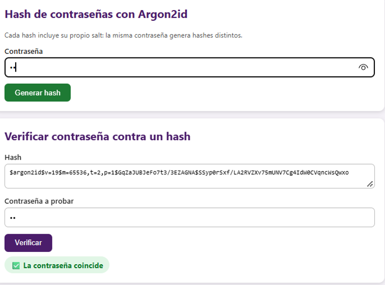

**Explicación:** finalmente, el hash generado se coloca en el campo de
verificación junto con una contraseña de prueba. La función
`sodium_crypto_pwhash_str_verify()` recalcula la comprobación usando los
parámetros incluidos en el hash. El mensaje `La contraseña coincide` indica
que la contraseña probada es correcta sin revelar la contraseña almacenada.
## 4.9. Resumen de las funciones utilizadas

| Función | Para qué sirve |
|---|---|
| `openssl_pkey_new()` | Genera un nuevo par de claves |
| `openssl_pkey_get_details()` | Obtiene detalles y la clave pública |
| `openssl_pkey_export()` | Exporta una clave privada a texto PEM |
| `openssl_pkey_export_to_file()` | Guarda una clave privada en un archivo |
| `openssl_sign()` | Genera una firma digital |
| `openssl_verify()` | Verifica una firma digital |
| `openssl_csr_new()` | Crea una solicitud de certificado |
| `openssl_csr_sign()` | Firma una CSR y genera un certificado |
| `openssl_x509_export()` | Exporta un certificado X.509 |
| `openssl_encrypt()` | Cifra datos con un algoritmo simétrico |
| `openssl_decrypt()` | Descifra datos previamente cifrados |
| `sodium_crypto_pwhash()` | Deriva una clave desde una contraseña |
| `sodium_crypto_secretbox()` | Cifra datos con autenticación integrada |
| `sodium_crypto_secretbox_open()` | Verifica y descifra un paquete autenticado |
| `sodium_crypto_sign_keypair()` | Genera un par de claves Ed25519 |
| `sodium_crypto_sign_detached()` | Genera una firma Ed25519 |
| `sodium_crypto_sign_verify_detached()` | Verifica una firma Ed25519 |
| `sodium_crypto_pwhash_str()` | Genera un hash de contraseña Argon2id |
| `sodium_crypto_pwhash_str_verify()` | Verifica una contraseña contra su hash |

# 5. 🔐 Documentación técnica de las funciones

Esta sección documenta el propósito, parámetros, retorno y proceso
criptográfico de las funciones principales utilizadas en cada script.

## 5.1. `firma7.php`

| Función | Propósito general | Parámetros recibidos | Valor devuelto | Proceso criptográfico |
|---|---|---|---|---|
| `openssl_pkey_new()` | Generar claves RSA | Opciones de configuración y tamaño | Recurso/objeto de clave o `false` | Crea la clave privada y su correspondiente clave pública |
| `openssl_pkey_get_details()` | Obtener la clave pública | Recurso de clave | Arreglo con detalles, incluida `key` | Extrae la clave pública para compartirla |
| `openssl_pkey_export()` | Exportar clave privada | Clave, variable de salida y opciones | `true` o `false` | Serializa la clave privada en formato PEM |
| `openssl_sign()` | Firmar el mensaje | Datos, firma de salida, clave privada y algoritmo | `true` o `false` | Calcula SHA-256 y firma el resumen con RSA |
| `openssl_verify()` | Verificar la firma | Datos, firma, clave pública y algoritmo | `1`, `0` o `-1` | Comprueba integridad y autenticidad del mensaje |

### 5.1.1. Flujo

Se genera el par RSA, se exportan las claves, se firma `$datos` y se verifica
la firma usando la clave pública. Los archivos generados permanecen fuera del
repositorio.

## 5.2. `firmaOtra.php`

| Función | Propósito general | Parámetros recibidos | Valor devuelto | Proceso criptográfico |
|---|---|---|---|---|
| `openssl_pkey_new()` | Crear el par RSA | Arreglo con tipo y tamaño | Recurso/objeto o `false` | Genera claves asimétricas |
| `openssl_csr_new()` | Crear una CSR | Identidad, clave privada y opciones | CSR o `false` | Asocia los datos de identidad con la clave pública |
| `openssl_csr_sign()` | Firmar la CSR | CSR, CA, clave y vigencia | Certificado X.509 o `false` | Produce un certificado autofirmado |
| `openssl_x509_export()` | Exportar certificado | Certificado y variable de salida | `true` o `false` | Serializa el certificado en PEM |

### 5.2.1. Flujo

El script construye `$dn`, genera las claves, crea la CSR y firma un certificado
local para fines didácticos. Un certificado autofirmado no sustituye la
validación de una autoridad certificadora en producción.

## 5.3. `FirmarMesaje.php`

| Función | Propósito general | Parámetros recibidos | Valor devuelto | Proceso criptográfico |
|---|---|---|---|---|
| `file_get_contents()` | Leer claves y certificado | Ruta del archivo | Cadena o `false` | Recupera el material PEM local |
| `openssl_pkey_get_private()` | Cargar clave privada | Cadena PEM | Clave o `false` | Prepara la clave para firmar |
| `openssl_sign()` | Firmar el mensaje | Mensaje, firma, clave y algoritmo | `true` o `false` | Firma SHA-256 con la clave privada |
| `base64_encode()` | Representar la firma | Datos binarios | Cadena Base64 | Facilita el transporte textual |
| `openssl_pkey_get_public()` | Cargar clave pública | Certificado o clave pública | Clave o `false` | Obtiene la clave para verificar |
| `openssl_verify()` | Validar firma | Mensaje, firma, clave y algoritmo | `1`, `0` o `-1` | Detecta alteraciones del mensaje |

## 5.4. `firmaDigital.php`

| Función | Propósito general | Parámetros recibidos | Valor devuelto | Proceso criptográfico |
|---|---|---|---|---|
| `openssl_pkey_new()` | Generar el par RSA | Opciones de OpenSSL | Clave o `false` | Genera clave privada y pública |
| `openssl_pkey_export_to_file()` | Guardar la clave privada | Clave, ruta y opciones | `true` o `false` | Escribe PEM en almacenamiento local |
| `openssl_pkey_get_details()` | Obtener la pública | Clave generada | Arreglo de detalles | Extrae la clave pública |
| `file_put_contents()` | Guardar la pública | Ruta y contenido PEM | Bytes escritos o `false` | Persiste la clave pública |

## 5.5. `encriptacionOpenssl_2.php`

| Función | Propósito general | Parámetros recibidos | Valor devuelto | Proceso criptográfico |
|---|---|---|---|---|
| `openssl_encrypt()` | Cifrar un mensaje | Texto, algoritmo, clave, opciones e IV | Texto cifrado o `false` | Aplica cifrado simétrico y produce datos binarios/Base64 |
| `base64_encode()` | Codificar el resultado | Datos binarios | Cadena Base64 | Permite mostrar o transportar el cifrado |

## 5.6. `Encriptacion.php`

| Función | Propósito general | Parámetros recibidos | Valor devuelto | Proceso criptográfico |
|---|---|---|---|---|
| `openssl_cipher_iv_length()` | Consultar tamaño del IV | Nombre del algoritmo | Entero o `false` | Determina el IV requerido por el modo |
| `random_bytes()` | Crear valores aleatorios | Cantidad de bytes | Cadena binaria | Genera IV impredecible |
| `openssl_encrypt()` | Cifrar con AES | Texto, algoritmo, clave, opciones e IV | Cifrado o `false` | CBC cifra, mientras GCM agrega autenticación |
| `openssl_decrypt()` | Descifrar con AES | Cifrado, algoritmo, clave, opciones e IV | Texto claro o `false` | Recupera el texto si los parámetros son válidos |
| `hash_equals()` | Comparar valores con seguridad | Dos cadenas | Booleano | Evita comparaciones vulnerables a tiempo |

## 5.7. `sodiumEjemplo.php`

| Función | Propósito general | Parámetros recibidos | Valor devuelto | Proceso criptográfico |
|---|---|---|---|---|
| `sodium_crypto_pwhash()` | Derivar una clave | Longitud, contraseña, salt y parámetros | Clave binaria | Argon2id dificulta ataques de diccionario |
| `sodium_crypto_secretbox()` | Cifrar autenticadamente | Mensaje, nonce y clave | Cifrado autenticado | XSalsa20-Poly1305 protege confidencialidad e integridad |
| `sodium_crypto_secretbox_open()` | Abrir el paquete | Cifrado, nonce y clave | Texto o `false` | Verifica autenticidad antes de descifrar |
| `sodium_crypto_sign_keypair()` | Crear claves Ed25519 | Sin parámetros | Par de claves | Genera claves para firma digital |
| `sodium_crypto_sign_detached()` | Firmar datos | Mensaje y clave privada | Firma binaria | Produce una firma Ed25519 separada del mensaje |
| `sodium_crypto_sign_verify_detached()` | Verificar firma | Firma, mensaje y clave pública | Booleano | Valida autenticidad e integridad |
| `sodium_crypto_pwhash_str()` | Crear hash de contraseña | Contraseña y límites de costo | Hash textual | Genera un hash Argon2id con salt incorporado |
| `sodium_crypto_pwhash_str_verify()` | Verificar contraseña | Hash y contraseña | Booleano | Recalcula y compara de forma segura |

# 6. 🧪 Investigación sobre Libsodium

## 6.1. ¿Qué es Libsodium?

Libsodium es una biblioteca criptográfica moderna que proporciona una API
portable y fácil de usar. En PHP se accede mediante la extensión `sodium`.
Su diseño reduce la cantidad de decisiones peligrosas que debe tomar el
desarrollador, como escoger manualmente modos de cifrado o formatos de nonce.

## 6.2. Características principales

- Cifrado autenticado con confidencialidad e integridad.
- Firmas digitales Ed25519.
- Derivación y hashing de contraseñas con Argon2id.
- Generación de valores aleatorios criptográficamente seguros.
- API de alto nivel con parámetros recomendados por defecto.
- Detección de alteraciones mediante códigos de autenticación.

## 6.3. `sodium_crypto_secretbox()`

Esta función cifra un mensaje con una clave secreta y un nonce único. El
resultado incluye un código de autenticación que permite detectar cambios en
el texto cifrado. El nonce no es secreto, pero nunca debe reutilizarse con la
misma clave.

## 6.4. `sodium_crypto_secretbox_open()`

Esta función verifica el código de autenticación y, únicamente si es válido,
descifra el paquete. Si el paquete fue alterado o la clave es incorrecta,
devuelve `false`. Por eso el ejemplo permite simular la modificación de un
byte y observar el rechazo.

## 6.5. Ejemplo ejecutable en PHP

El archivo `sodiumEjemplo.php` presenta cuatro operaciones: cifrar, descifrar,
firmar y generar/verificar hashes de contraseñas. El paquete de cifrado
contiene `salt`, `nonce` y texto cifrado en Base64, sin exponer la clave
derivada.

### 6.5.1. Explicación del ejemplo

1. Se genera un `salt` aleatorio.
2. Argon2id deriva una clave de 32 bytes desde la contraseña.
3. Se genera un nonce único.
4. `secretbox` cifra y autentica el mensaje.
5. Al descifrar, `secretbox_open` valida antes de devolver el texto.
6. Ed25519 firma el mensaje y valida si no fue modificado.
7. Argon2id genera un hash verificable para almacenar contraseñas.

## 6.6. Diferencias generales entre OpenSSL y Libsodium

| Aspecto | OpenSSL | Libsodium |
|---|---|---|
| Alcance | Biblioteca extensa y compatible con muchos estándares | API criptográfica moderna de alto nivel |
| Cifrado | AES, RSA y múltiples modos configurables | Secretbox y otros esquemas autenticados |
| Firmas | RSA y certificados X.509 | Ed25519 con API sencilla |
| Contraseñas | Requiere elegir y combinar funciones | Incluye Argon2id mediante funciones específicas |
| Riesgo de configuración | Mayor por la cantidad de parámetros | Menor por valores seguros y primitivas enfocadas |
| Uso recomendado | Interoperabilidad, PKI y sistemas existentes | Nuevos desarrollos que necesitan una API segura |

# 7. 💭 Conclusiones personales

## 7.1. Conclusión de Hanna Licona

La práctica permitió comprobar que una firma digital no cifra necesariamente
el mensaje, sino que demuestra su integridad y autenticidad. También se
comprendió la importancia de proteger la clave privada y de no incluirla en un
repositorio público.

Además, el laboratorio mostró la diferencia entre cifrado simétrico,
criptografía asimétrica, hashing y firmas. Libsodium facilita operaciones
seguras como `secretbox`, Ed25519 y Argon2id, mientras OpenSSL resulta útil
cuando se necesita compatibilidad con RSA, AES y certificados.

---

## 📄 Requisitos para la entrega en PDF

- Consolidar este informe en un documento PDF.
- Incluir numeración visible de páginas en el pie, excepto la portada.
- Mantener las tablas técnicas ordenadas y legibles.
- Conservar las capturas con una descripción de lo que se observa.
- Sustituir los marcadores `<nombre>`, `<cédula>` e `<integrante>` antes de
  entregar.

**Repositorio del proyecto:**  
https://github.com/hlemerix/openSSL-HL
